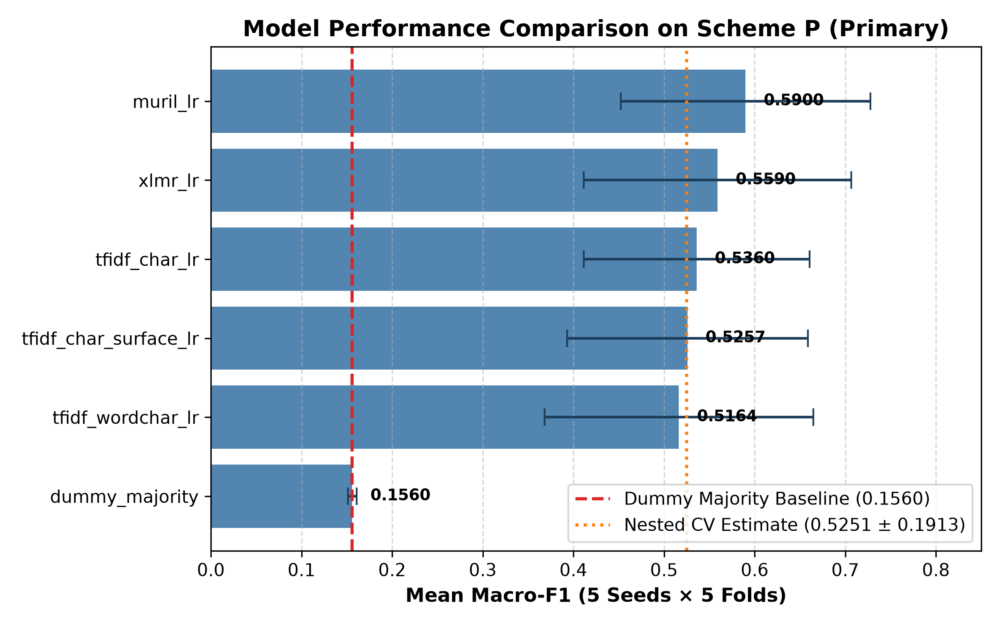
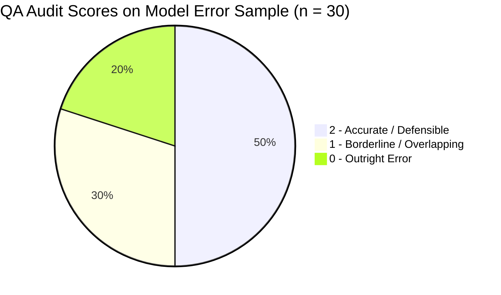
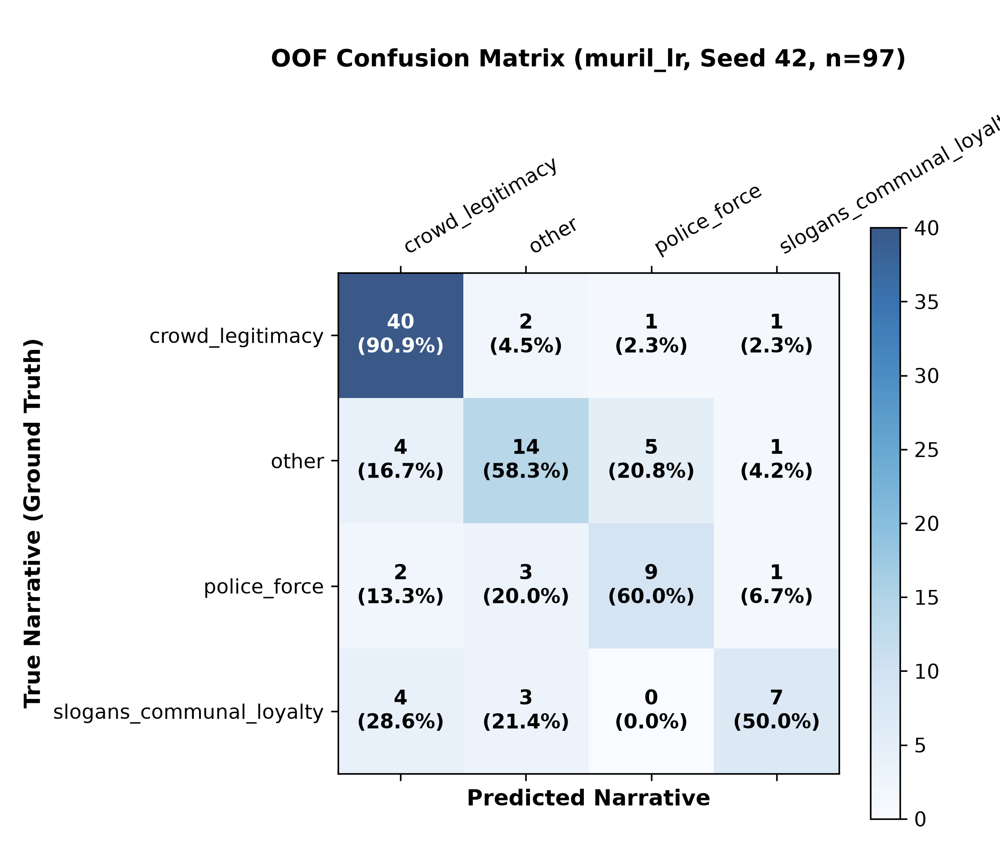
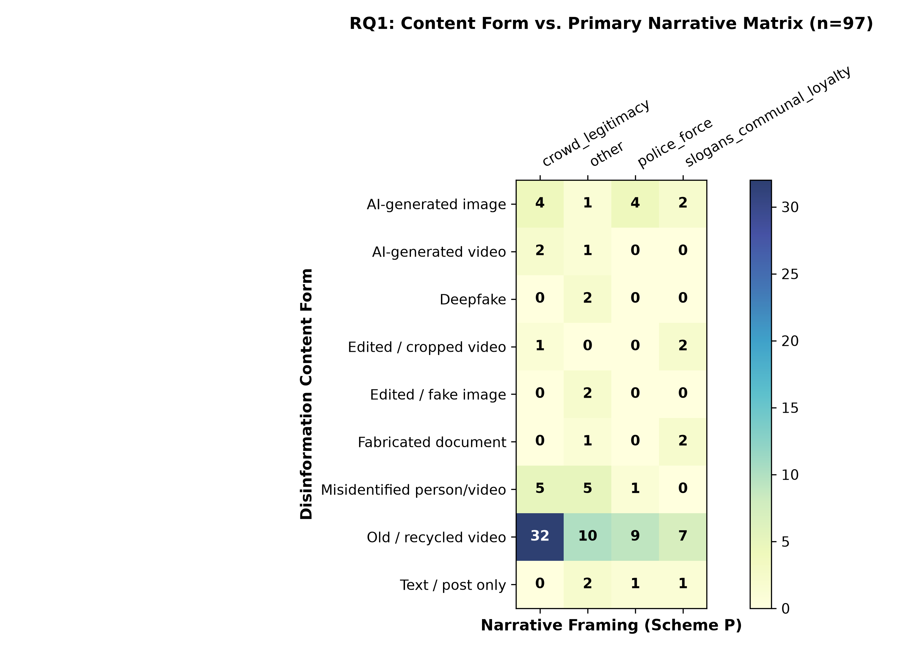

# Technical Report: Automated Triage of Disinformation Narratives in the 2026 CJP Protests

**Dataset SHA-256 Checksum:** `1b9076758b80006b3f950001ccd2f471576fd8fcaa4f92d75f40d6280c59a30f`  
**Date:** November 2026  
**AI-Assistance Disclosure:** AI coding assistants were used to write and test the analysis code and to draft documentation. All narrative, content-form and direction labels were assigned by the team's human coders (A, B) and adjudicator (C).

---

## Abstract

This investigation evaluates the feasibility of machine learning and frozen multilingual transformer representations for the automated triage of disinformation narratives surrounding the Cockroach Janata Party (CJP) student protests in New Delhi (June–July 2026). Using a curated dataset of 97 fact-checked claim records (85 unique claims) debunked across 13 fact-checking outlets/desks, we benchmark 6 model configurations across 5-fold grouped, stratified cross-validation repeated across 5 random seeds (25 folds total). Our findings show that `muril_lr` is the highest-scoring candidate under the pre-set rule, achieving a mean fold Macro-F1 of **0.5900 ± 0.1377** (nested CV estimate: **0.5251 ± 0.1913**), compared to the dummy majority baseline (**0.1560 ± 0.0047**). However, the candidates are not clearly separable: the mean differences between the top three candidates (+0.03 to +0.05) are smaller than the fold standard deviations (0.10 to 0.15), and no single model is demonstrably best. Cross-temporal evaluation degrades to **0.4056** on a single holdout split of the final 20% of claims (single split, unstable). Crucially for Research Question 1 (RQ1), descriptive analysis reveals that in this sample of fact-checked claim records, shallow, recycled video constitutes **59.8%** (58/97 records), whereas generative AI imagery, video, and deepfakes comprise **16.5%** (16/97 records), yielding a ratio of **58 : 16** (about **3.6 : 1**). Fact-checkers choose which claims to debunk, so this represents the distribution in fact-checked claims rather than the online prevalence of any content type. Automated models could support triage if validated further, but cannot replace human judgment or detect synthetic provenance.

---

## 1. Scope and Research Questions

### 1.1 Research Questions (Proposal Specification)
This study is structured around the four research questions established in the project proposal:
- **RQ1:** What kinds of misleading or synthetic content were recorded, and what narratives did the claims back up?
- **RQ2:** How did fact-checkers and public agencies verify the claims, and where did their accounts disagree?
- **RQ3:** Can a multilingual classifier help researchers sort claim narratives without replacing human judgement, and what errors does it make across English, Hindi and Hinglish?
- **RQ4:** What human harms are documented, and what communication recommendations are supported by this evidence?

### 1.2 Empirical Coverage and Scope Boundaries
- **RQ1 is partly answered:** Section 7 provides the empirical cross-tabulation of media content forms against narrative categories across all 97 records.
- **RQ3 is answered:** Sections 4, 5, and 6 evaluate multilingual classifiers, report grouped cross-validation scores, evaluate language subgroups, and detail an error taxonomy across English, Hindi, and Hinglish.
- **RQ2 and RQ4 are NOT answered by the labelled dataset:** The structured coding sheet contains no verification-method taxonomy, correction timestamps, or quantified harm evidence. **RQ2 and RQ4 require separate qualitative case-study write-ups drawn directly from the fact-check narrative reports.**
- **The Model Predicts Narrative Framing Only:** The classification targets are communicative themes (e.g., alleging police force vs. challenging crowd turnout).
- **The Model is NOT an AI Detector:** The model evaluates claim text only. It does not inspect images or videos and cannot determine whether media is synthetic.
- **The Model is NOT a Fact-Checker or Truth Arbiter:** It cannot verify real-world factual truth.
- **The Model is NOT for Automated Moderation:** Model predictions must not be used to automate content moderation or account enforcement.

---

## 2. Dataset and Data Collection

### 2.1 Data Collection Pipeline
Data collection combined automated API retrieval with manual claim curation:
1. **Fact Check Tools API Retrieval:** We queried the free Google Fact Check Tools API using 7 search terms (`["CJP protest", "Cockroach Janta Party", "Jantar Mantar protest", "lathicharge protest Delhi", "NEET protest Delhi", "women CJP protesters", "CJP student protest"]`) across English (`en`) and Hindi (`hi`), retrieving **208 raw API records** (`data/raw/factcheck_api_claims.csv`).
2. **Deduplication & Temporal Filtering:** Deduplicating and filtering for the temporal window (June 6 to July 25, 2026) retained **86 records** from the API.
3. **Manual Search Rows & Provenance Audit:** An initial set of **73 manual claim rows** was assembled by an AI agent from search results. A strict URL provenance audit inspecting every link over HTTP revealed that **62 rows** had dead, parked, or redirecting links. These 62 rows were quarantined (`data/raw/manual_claims_quarantine.csv`, documented in `qa/qa_manual_audit.md` and `qa/unverified.md`). Exactly **11 verified manual rows** were retained.
4. **Combined Analysis Dataset:** Merging the 86 API records and 11 verified manual records yielded the final dataset of **97 records** representing **85 unique claims** (`claim_id`), serialized to `data/processed/final_labels.csv`.

### 2.2 Coverage and Outlets
- **Outlets:** Debunked across **13 fact-checking outlets/desks** (The Quint [16], BOOM [15], FACTLY [11], AFP Fact Check [9], Vishvas News [7], Alt News [6], NewsMobile [6], Press Trust of India [6], Lighthouse Journalism [6], AajTak [6], Telugu Post [5], India Today [3], DigitEye India [1]).
- **Temporal Distribution:**
  - June 2026: **16 rows** (16 unique claims)
  - July 2026: **78 rows** (67 unique claims)
  - Undated `claim_date`: **3 rows** (3 unique claims: `C0002` [R0003], `C0044` [R0045], `C0076` [R0077]). In all three cases, the `review_date` is in July 2026, accounting for earlier preliminary tallies reporting 81 July rows.

### 2.3 Privacy Scrubbing
- All personal usernames, private profile URLs, and names of private citizens were stripped from analytical files.
- The free-text `origin_note` field was replaced with a boolean flag `origin_note_present` (present in 4 records). Automated tests strictly assert zero occurrences of handle patterns.

---

## 3. Labelling Process and Human Adjudication

### 3.1 Labelling Workflow
- **Labelling Process & Roles:** Two team members (Coders A and B) filled their coding sheets independently of each other across four coded columns: relevance, narrative, content form, and direction. A third team member (Coder C) resolved all conflicts into the final adjudicated sheet (`data/raw/C_final.xlsx`).
- **Raw Cell Agreement:**
  - Across the four coded columns ($97 \times 4 = 388$ cells), exactly **20 cell conflicts** occurred between Coders A and B (5.2% of cells), yielding a **raw cell agreement of 94.8%**.
  - This metric represents raw percentage agreement across cells; it is not chance-corrected, does not represent formal inter-coder reliability, and excludes the free-text Origin column.
  - The original independent sheets for Coders A and B were not retained after adjudication. Consequently, Cohen's kappa and per-field inter-coder agreement cannot be computed and are not computable from the supplied files.

### 3.2 Label Vocabulary & Approved Proposal Mapping
The labelling sheet utilized a native 13-category taxonomy. To evaluate alignment with the proposal's 6 target categories, we established `narrative_mapping.csv` (status: `APPROVED by team`).

To prevent un-trainable classes during grouped cross-validation, classes with fewer than 8 distinct claims were merged into `other` (Scheme P) or `other_merged` (Scheme N). In Scheme P, `other` (24 rows, 21 claims) is a mixed residual category that folded `protester_violence` (7 rows, 5 claims) and `individual_targeting` (7 rows, 6 claims) into native administrative `other` (10 rows, 10 claims).

```mermaid
graph TD
    A["Native Vocabulary (13 Categories)"] -->|Category Rules| B["Proposal Codes (6 Categories)"]
    A -->|Rare-Class Threshold (< 8 claims)| C["Scheme P (4 Final Classes)"]
    A -->|Rare-Class Threshold (< 8 claims)| D["Scheme N (5 Final Classes)"]
    
    subgraph Scheme P Classes
    C1["crowd_legitimacy (44 rows / 35 claims)"]
    C2["other (mixed residual: 24 rows / 21 claims)"]
    C3["police_force (15 rows / 15 claims)"]
    C4["slogans_communal_loyalty (14 rows / 14 claims)"]
    end
```

---

## 4. Methodology

### 4.1 Model Configurations
1. **`dummy_majority`:** Baseline classifier predicting the most frequent training class (`crowd_legitimacy`).
2. **`tfidf_char_lr`:** Sub-word character n-grams (2–5 `char_wb`) with balanced Logistic Regression ($C=1.0$).
3. **`tfidf_wordchar_lr`:** Feature union of character n-grams (2–5) and word n-grams (1–2) with balanced Logistic Regression.
4. **`tfidf_char_surface_lr`:** Ablation combining character n-grams with 10 standardized surface features.
5. **`xlmr_lr`:** Mean-pooled representations from frozen `xlm-roberta-base` (768 dimensions) with StandardScaler and balanced Logistic Regression.
6. **`muril_lr`:** Mean-pooled representations from frozen `google/muril-base-cased` (768 dimensions) with StandardScaler and balanced Logistic Regression.
*(Note: Transformer encoder models were executed locally with pre-cached weights.)*

### 4.2 Grouped, Stratified Cross-Validation
- **Folds:** 5-fold StratifiedGroupKFold grouped strictly on `claim_id`.
- **Seeds:** 5 random seeds (`[42, 43, 44, 45, 46]`), yielding 25 fold evaluations per model. Note: because the 25 folds represent 5 repeated splits on the same 85 claims, they are not statistically independent.
- **Nested Cross-Validation:** Outer 5-fold grouped CV wrapping an inner 3-fold model selection loop to evaluate selection procedure stability.
- **Model Selection Rule:** Fixed in advance as highest mean fold Macro-F1 on Scheme P.

---

## 5. Results (RQ3)

### 5.1 Primary Scheme P Results (4 Classes, n=97 rows, 85 claims)

| model | mean_macro_f1 | std_macro_f1 | pooled_oof_macro_f1_seed42 | n_rows | n_claims |
| --- | --- | --- | --- | --- | --- |
| muril_lr | 0.59 | 0.1377 | 0.6608 | 97 | 85 |
| xlmr_lr | 0.559 | 0.1477 | 0.5552 | 97 | 85 |
| tfidf_char_lr | 0.536 | 0.1247 | 0.5453 | 97 | 85 |
| tfidf_char_surface_lr | 0.5257 | 0.1329 | 0.4962 | 97 | 85 |
| tfidf_wordchar_lr | 0.5164 | 0.1483 | 0.5042 | 97 | 85 |
| dummy_majority | 0.156 | 0.0047 | 0.156 | 97 | 85 |

- **Model Comparison:** `muril_lr` is the highest-scoring candidate under the pre-set rule (mean Macro-F1: **0.5900 ± 0.1377**). However, the candidates are not clearly separable: the mean gaps between `muril_lr`, `xlmr_lr` (0.5590), and `tfidf_char_lr` (0.5360) are smaller than the fold standard deviations (0.12 to 0.15), and no single model is demonstrably best.
- **Nested Cross-Validation Estimate:** **0.5251 ± 0.1913**. Outer fold model selections varied across four different models: ['muril_lr', 'tfidf_char_lr', 'muril_lr', 'xlmr_lr', 'tfidf_wordchar_lr'].



### 5.2 Paired Differences Against Dummy Baseline (Scheme P, 25 Folds)

| model | mean_paired_diff | std_paired_diff | fold_win_count | total_folds |
| --- | --- | --- | --- | --- |
| dummy_majority | 0.0 | 0.0 | 0 | 25 |
| tfidf_char_lr | 0.38 | 0.1235 | 25 | 25 |
| tfidf_wordchar_lr | 0.3604 | 0.1467 | 25 | 25 |
| tfidf_char_surface_lr | 0.3697 | 0.1318 | 25 | 25 |
| xlmr_lr | 0.403 | 0.1464 | 25 | 25 |
| muril_lr | 0.434 | 0.1369 | 25 | 25 |

All models beat the dummy majority baseline across 25 of 25 evaluation folds. However, because folds across seeds share the same 85 claims, this is weaker evidence than 25 independent trials.

### 5.3 Paired Differences Between Top Three Models (Scheme P, 25 Folds)

| model_a | model_b | mean_paired_diff | std_paired_diff | model_a_wins | ties | model_b_wins | total_folds |
| --- | --- | --- | --- | --- | --- | --- | --- |
| muril_lr | xlmr_lr | 0.031 | 0.1311 | 16 | 1 | 8 | 25 |
| muril_lr | tfidf_char_lr | 0.054 | 0.1041 | 18 | 0 | 7 | 25 |
| xlmr_lr | tfidf_char_lr | 0.023 | 0.1159 | 15 | 1 | 9 | 25 |

The mean differences between top candidates (+0.023 to +0.054) are smaller than their fold standard deviations (0.10 to 0.13), demonstrating that candidate performances overlap substantially.

### 5.4 Secondary Scheme N Results (5 Classes, n=97 rows, 85 claims)

| model | mean_macro_f1 | std_macro_f1 | pooled_oof_macro_f1_seed42 | n_rows | n_claims |
| --- | --- | --- | --- | --- | --- |
| tfidf_wordchar_lr | 0.6081 | 0.1251 | 0.5926 | 97 | 85 |
| tfidf_char_lr | 0.6007 | 0.1082 | 0.6031 | 97 | 85 |
| muril_lr | 0.5379 | 0.0922 | 0.5651 | 97 | 85 |
| xlmr_lr | 0.4625 | 0.145 | 0.4882 | 97 | 85 |
| tfidf_char_surface_lr | 0.4187 | 0.1685 | 0.4417 | 97 | 85 |
| dummy_majority | 0.1287 | 0.0048 | 0.1287 | 97 | 85 |

On the native 5-class problem, sub-word character TF-IDF models (`tfidf_wordchar_lr` at 0.6081 and `tfidf_char_lr` at 0.6007) scored higher than transformer embeddings on this specific split.

### 5.5 Sensitivity Analysis (Excluding 4 Related Records, n=93 rows, 82 claims)

| model | mean_macro_f1 | std_macro_f1 | pooled_oof_macro_f1_seed42 | n_rows | n_claims |
| --- | --- | --- | --- | --- | --- |
| xlmr_lr | 0.5806 | 0.132 | 0.6256 | 93 | 82 |
| muril_lr | 0.5675 | 0.1227 | 0.572 | 93 | 82 |
| tfidf_char_lr | 0.5392 | 0.1188 | 0.5497 | 93 | 82 |
| tfidf_wordchar_lr | 0.5209 | 0.142 | 0.5309 | 93 | 82 |
| tfidf_char_surface_lr | 0.4862 | 0.102 | 0.4561 | 93 | 82 |
| dummy_majority | 0.153 | 0.0054 | 0.153 | 93 | 82 |

On Scheme P ($n=97$), model rankings by mean Macro-F1 are `muril_lr` (0.5900) > `xlmr_lr` (0.5590) > `tfidf_char_lr` (0.5360) > `tfidf_char_surface_lr` (0.5257) > `tfidf_wordchar_lr` (0.5164). On the sensitivity subset excluding the 4 Related records ($n=93$), model rankings do not remain preserved: `xlmr_lr` moves to first place (0.5806, +0.0216), `muril_lr` drops to second (0.5675, -0.0225), `tfidf_wordchar_lr` (0.5209, +0.0045) overtakes `tfidf_char_surface_lr` (0.4862, -0.0395), while `tfidf_char_lr` remains in third place (0.5392, +0.0032).

### 5.6 Language Subgroup Evaluation (Seed 42 OOF)

| lang_group | n_rows | macro_f1 | status |
| --- | --- | --- | --- |
| devanagari | 14 | nan | too few rows; describe errors qualitatively |
| english_likely | 61 | 0.696 | scored |
| hinglish_likely | 22 | nan | too few rows; describe errors qualitatively |

Claims categorized as `english_likely` ($n=61$ rows) achieved Macro-F1 = **0.6960** on seed 42 OOF. `hinglish_likely` ($n=22$ rows) and `devanagari` ($n=14$ rows) have too few rows to score reliably. Note: `lang_group` was determined by an unverified heuristic (a short Romanized-Hindi word list) that was not confirmed by human annotators.

### 5.7 Temporal Holdout Check (80/20 Chronological Split)
- **Train Split (Earliest 80%):** 66 claims (77 records) from June 6 to July 21, 2026.
- **Test Split (Latest 20%):** 17 claims (17 records) from July 22 to July 25, 2026.
- **Result:** Macro-F1 = **0.4056** (*single split, unstable*).
- **Interpretation:** Performance on late-period claims dropped to 0.4056. Whether this reflects evolving claim topics over time or small-sample test set variance is an untested hypothesis.

---

## 6. Error Analysis & Qualitative Audits

### 6.1 Audit Methodology
A qualitative QA audit (`model_errors`) was performed on 30 records drawn from the seed 42 OOF predictions of `muril_lr`, deliberately enriched to 15 errors and 15 correct predictions. Every record was reviewed by reading the primary source fact-check first before inspecting model outputs.



### 6.2 Primary Failure Modes
1. **`crowd_legitimacy` Over-Prediction (4 cases):** High class prevalence (45.4%) creates an inductive pull on claims describing general protest assembly or organizer conduct.
2. **Narrative Overlap (5 cases):** Boundary ambiguities between VIP appearances and slogan claims (e.g., Arundhati Roy's Kashmir speech, Christian pastors joining protest).
3. **Lexical Keyword Trigger Confusion (1 case):** In Devanagari Hindi (`R0061`), the co-occurrence of police and death keywords triggered `police_force`, failing to register that protesters were accused of killing the officer.
4. **Thin Text (1 case):** 5-word telegraphic claim (*"Videos show recent CJP protests"*, `R0009`) provided insufficient semantic signal.



---

## 7. Descriptive Findings for RQ1

**Research Question 1:** *What kinds of misleading or synthetic content were recorded, and what narratives did the claims back up?*

### Content Form by Narrative Matrix (Scheme P, n=97)

| content_form_native | crowd_legitimacy | other | police_force | slogans_communal_loyalty | All |
| --- | --- | --- | --- | --- | --- |
| AI-generated image | 4 | 1 | 4 | 2 | 11 |
| AI-generated video | 2 | 1 | 0 | 0 | 3 |
| Deepfake | 0 | 2 | 0 | 0 | 2 |
| Edited / cropped video | 1 | 0 | 0 | 2 | 3 |
| Edited / fake image | 0 | 2 | 0 | 0 | 2 |
| Fabricated document | 0 | 1 | 0 | 2 | 3 |
| Misidentified person/video | 5 | 5 | 1 | 0 | 11 |
| Old / recycled video | 32 | 10 | 9 | 7 | 58 |
| Text / post only | 0 | 2 | 1 | 1 | 4 |
| All | 44 | 24 | 15 | 14 | 97 |



### Key Empirical Takeaways:
1. **Shallow Fakes Outnumber Generative AI 58 : 16 (about 3.6 : 1):** In this sample of fact-checked claim records, 59.8% (58/97) consisted of recycled historical footage from earlier unrelated demonstrations, compared to 16.5% (16/97) for all generative AI formats combined (images, videos, deepfakes). Because fact-checkers choose which claims to debunk, this reflects the distribution in debunked claims rather than the prevalence of content types online.
2. **AI Imagery Focuses on Crowd Inflation and Fabricated Casualties:** Generative visuals were concentrated in manufacturing false crowd attendance (`crowd_legitimacy`, n=6, comprising 4 AI-generated images and 2 AI-generated videos) and fabricating police casualty memorials (`police_force`, n=4 AI-generated images: `R0087`–`R0090`).
3. **Explicit Boundary Regarding RQ2 and RQ4:** The labelled dataset contains no verification-method records, correction timestamps, or quantified harm evidence. Consequently, **RQ2 (verification accounts and disagreements) and RQ4 (human harms and recommendations) are NOT answered by this sheet** and require separate qualitative case-study write-ups from the fact-check reports.

---

## 8. Limitations

1. **Modest Sample Size:** 97 records across 85 claims restricts statistical power and limits the number of sustainable classes to 4.
2. **Fact-Checker Selection Bias:** The dataset reflects claims chosen by newsrooms for debunking (skewed toward virality, prominent figures, and clear falsifiability).
3. **Class Imbalance:** `crowd_legitimacy` accounts for 45.4% of records, biasing text representations toward crowd turnout themes.
4. **Pre-Adjudication Agreement Retention:** While team members (Coders A and B) coded independently, the original sheets were not retained after adjudication by Coder C. Cohen's kappa and per-field inter-coder agreement cannot be computed, so only raw cell agreement (94.8%, 20 cell conflicts out of 388 cells) can be reported; this is not chance-corrected.
5. **Linguistic Representation:** `lang_group` is an unverified heuristic (a short Romanized-Hindi word list) that no human confirmed. The corpus also lacks regional Dravidian or Eastern Indic languages.
6. **Automated Access Restriction for R0059:** Record `R0059` remains categorized as `other`; its source fact-check page could not be opened by automated extraction tools due to site anti-bot protection.
7. **Alternative Reading of Individual Smears in Foreign/Conspiracy Category:** Records `R0046`, `R0051`, and `R0054` remain categorized as `slogans_communal_loyalty` as approved; these 3 of 14 rows concern named individuals (e.g., organizer Abhijeet Dipke and the Prime Minister) and would be classified as `individual_targeting` (merged into `other`) under an alternative reading. No model re-run was performed.

---

## 9. Deviations from Proposal

1. **Claim Records vs. Direct Posts:** Data was collected from published fact-checking investigations rather than 500+ direct platform posts due to platform API constraints.
2. **Platform Access Constraints:** Twitter/X API access was unavailable due to pricing barriers; Instagram content was captured exclusively through fact-checker citations.
3. **Label Taxonomy Harmonization:** The team's native 13-category schema differed from the proposal's 6 categories and was mapped (`narrative_mapping.csv`, approved by team).
4. **Quarantine of Manual Rows:** 62 of 73 manually collected claim rows were quarantined after a URL provenance audit found dead, parked, or redirecting links. These rows were originally assembled by an AI agent from search results; 11 verified manual rows remain.
5. **AI Coding Disclosure:** AI coding assistants were used to write and test the analysis code and to draft documentation. All narrative, content-form and direction labels were assigned by the team's human coders (A, B) and adjudicator (C).

---

## 10. Ethics and Privacy

- **No Surveillance or Censorship:** The system is designed for scholarly retrospective research and newsroom claim routing, not user tracking or automated censorship.
- **Strict Privacy Protection:** All social media usernames, individual phone numbers, and non-public individual identities have been removed from all analytical files.
- **Content Storage Policy:** We store links and short claim summaries and do not reproduce article text.

---

## Appendix A: Native Label Definitions and Proposal Mapping Table

| Native Label | Proposal Code | Mapping Level | Record IDs | Rationale | Status |
| :--- | :--- | :--- | :--- | :--- | :--- |
| Endorsement / solidarity claim | `crowd_legitimacy` | Category | all | VIP visits, external solidarity statements | APPROVED by team |
| Crowd size / legitimacy | `crowd_legitimacy` | Category | all | Turnout claims, drone visuals, crowd density | APPROVED by team |
| Moral / cultural smear | `crowd_legitimacy` | Category | all | Conduct smears challenging crowd demeanor | APPROVED by team |
| Police brutality / state repression | `police_force` | Category | all | Unlawful lathi-charge, tear gas, physical assaults | APPROVED by team |
| Fabricated casualties | `police_force` | Category | all | Manufactured protester death or ICU claims | APPROVED by team |
| Communal / anti-national framing | `slogans_communal_loyalty` | Category | all | Islamic slogans, anti-national chant allegations | APPROVED by team |
| Foreign / conspiracy link | `slogans_communal_loyalty` | Category | all | Foreign funding or extremist group ties | APPROVED by team |
| Protester violence / vandalism | `other` *(merged)* | Category | all | Stone pelting, train/bus arson (< 8 claims) | APPROVED by team |
| Personal smear of leader | `other` *(merged)* | Category | all | Organizer Dipke private life smears (< 8 claims) | APPROVED by team |
| Pro-police counter-narrative | `other` | Category | all | Pro-police rallies, civilian counter-protests | APPROVED by team |
| Political attack on govt/BJP | `other` | Category | all | Minister satire, policy rumors | APPROVED by team |
| Delegitimizing / mockery | `crowd_legitimacy` | Row | R0016; R0074; R0080; R0086 | Student gaffes, AI turnout challenges | APPROVED by team |
| Fabricated document / statement | `other` | Row | R0027 | Fake minister resignation letter | APPROVED by team |
| Fabricated document / statement | `other` | Row | R0059 | Police video memo (automated tools blocked; stays in other) | APPROVED by team |

---

## Appendix B: Reproduction Commands and Environments

```bash
# 1. Environment Setup
python3 -m venv .venv && source .venv/bin/activate
pip install -r requirements.txt

# 2. Dataset Ingestion & Validation
python3 ingest_final.py

# 3. Model Training & Evaluation
python3 03_train_eval.py

# 4. Report Rebuild & Figure Generation
python3 build_report.py

# 5. CLI Inference Smoke Test
python3 predict.py --smoke-test

# 6. Test Suite Execution
pytest tests/ -v
```

- **Random Seeds:** Main evaluation seed = 42; Cross-validation seeds = `[42, 43, 44, 45, 46]`.
- **Verified Environment:** Python 3.12.5 (macOS Darwin 24.6.0).

---

## Appendix C: Repository File Index

- `data/raw/C_final.xlsx`: Raw ground-truth workbook (97 rows).
- `data/processed/final_labels.csv`: Sanitized, joined analysis dataset (97 rows, 85 claims).
- `narrative_mapping.csv`: Complete native-to-proposal mapping rules.
- `03_train_eval.py`: Feature extraction, cross-validation, and model serialization.
- `predict.py`: Standalone CLI triage inference script with mandatory caveat.
- `outputs/final_model/model.joblib`: Serialized best model (`muril_lr`).
- `outputs/final_model/model_card.md`: Standard model documentation card.
- `qa/qa_mapping_audit.md`: Qualitative audit of label mapping rules.
- `qa/qa_label_audit.md`: Qualitative audit of human workbook labels.
- `qa/qa_model_errors.md`: Qualitative audit of model out-of-fold prediction errors.
- `privacy_log.md`: Privacy audit ledger verifying zero handle exposures.
- `REPORT.md`: This comprehensive technical report.
- `README.md`: Project documentation and quickstart instructions.
