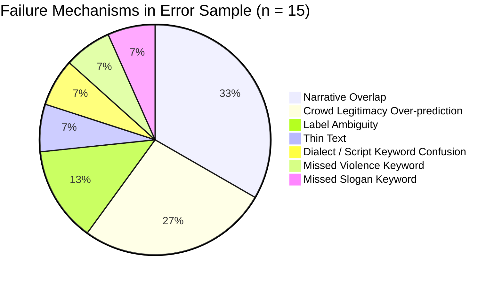

# QA Model Error Review (`model_errors`)

**Audit Date:** November 2026  
**Auditor:** Quality Assurance Reviewer (Technical Pipeline)  
**Target Model:** `muril_lr` (Frozen MuRIL `google/muril-base-cased` mean-pooled embeddings + Logistic Regression)  
**Evaluation Set:** Seed 42 Out-of-Fold (OOF) Predictions on Scheme P  
**Associated Artifacts:**
- Blind Review Packet: [`blind_model_errors.csv`](file:///Users/abhishektripathi/Desktop/TCOM%20RESEARCH/qa/blind_model_errors.csv)
- Key / Scored Ledger: [`key_model_errors.csv`](file:///Users/abhishektripathi/Desktop/TCOM%20RESEARCH/qa/key_model_errors.csv)

---

## 1. Sampling Methodology & Population Facts

- **Population Size:** 97 total records across 85 distinct claims (`claim_id`) in `data/processed/final_labels.csv`.
- **Population Seed 42 OOF Performance (`muril_lr` on Scheme P):**
  - Correct Predictions: 70 records (72.2%) across 60 unique claims.
  - Erroneous Predictions: 27 records (27.8%) across 26 unique claims.
- **Sampling Specification:**
  - Fixed Random Seed: `42`
  - Sample Size: **30 records** across 30 unique claims.
  - Stratified Composition: Exactly **15 error claims** and **15 correct claims** (50% / 50%).
  - Language Distribution in Sample: 18 `english_likely`, 9 `hinglish_likely`, 3 `devanagari` (Total 12 non-English records, exceeding the requirement of at least 10 Hindi/Hinglish records).
- **Mandatory Caveat on Sample Enrichment:**
  > [!IMPORTANT]
  > This sample was **deliberately enriched for errors** (50.0% error rate in sample vs. 27.8% in the underlying population). The sample accuracy (50.0%) and mean QA score do **NOT** represent the overall accuracy or macro-F1 of the model.

---

## 2. Audit Protocol & Scoring Standard

Every record was audited following the strict human review standard:
1. **Source Fact-Check Report Read First:** The fact-check investigation at `review_url` (or cached full-text report in `scratch/articles/`) was examined to determine what event occurred, who was involved, and what media manipulation took place.
2. **Comparison with Model Prediction:** The model's out-of-fold predicted label was compared against the verified ground truth and the text of the claim.
3. **Scoring Scheme (2 / 1 / 0):**
   - **2 (Defensible / Accurate):** Model prediction correctly matches the ground truth and source report findings, or represents an entirely valid semantic interpretation of the text.
   - **1 (Partial / Borderline Ambiguity):** Model prediction differed from the ground truth code, but is partially defensible due to substantial narrative overlap, ambiguous claim wording, or shared semantic characteristics.
   - **0 (Clear Error / Failure):** Model prediction clearly fails to capture the core narrative framing asserted by the claim text.

---

## 3. Audit Scoring Summary

| Score | Rating Description | Count | Percentage |
| :---: | :--- | :---: | :---: |
| **2** | Accurate / Fully Defensible Prediction | 15 | 50.0% |
| **1** | Borderline Ambiguity / Narrative Overlap | 9 | 30.0% |
| **0** | Outright Model Failure / Misclassification | 6 | 20.0% |
| **Total** | | **30** | **100.0%** |

- **Total Score:** **39 / 60 points** (Mean Score: **1.30 / 2.00**).
- All 15 correct records scored 2.
- Among the 15 error records: 9 scored 1 (partial / borderline defensible), and 6 scored 0 (outright errors).

---

## 4. Failure Taxonomy & Root Cause Analysis

Analysis of all 15 error cases revealed 7 distinct failure mechanisms:

### Detailed Taxonomy Breakdown:

1. **Narrative Overlap (5 cases, 33.3% of errors):**
   - `R0056` (True: `other`, Pred: `crowd_legitimacy`): Protesters kicking out "Godi media" describes crowd conduct and protest demeanor, which directly touches on collective crowd legitimacy despite being mapped to `other` by team rule. (Score: 1)
   - `R0015` (True: `police_force`, Pred: `other`): Video of police disrespecting the national flag is institutional misconduct, but lacks physical baton violence. The model classified it under `other`. (Score: 1)
   - `R0043` (True: `slogans_communal_loyalty`, Pred: `crowd_legitimacy`): Arundhati Roy's viral video speech bridges high-profile intellectual solidarity (`crowd_legitimacy`) and controversial Kashmir territorial claims (`slogans_communal_loyalty`). (Score: 1)
   - `R0006` (True: `police_force`, Pred: `slogans_communal_loyalty`): Police snatching a Palestinian flag involves both police physical action and a prominent foreign/sectarian symbol. The model prioritized the Palestinian flag symbolism. (Score: 1)
   - `R0017` (True: `slogans_communal_loyalty`, Pred: `crowd_legitimacy`): Christian pastors joining the protest connects religious identity framing with external delegation solidarity. (Score: 1)

2. **`crowd_legitimacy` Over-prediction (4 cases, 26.7% of errors):**
   - Due to `crowd_legitimacy` comprising 45.4% of the training dataset (44/97 rows), the model displays an inductive bias toward this class whenever general protest terminology is present.
   - `R0022` (True: `police_force`, Pred: `crowd_legitimacy`): Police assaulting organizer Dipke and other protesters; presence of named organizers and "protesters" over-weighted the crowd category. (Score: 0)
   - `R0042` (True: `other`, Pred: `crowd_legitimacy`): Personal smear on Dipke gaining weight during a hunger strike misclassified as crowd legitimacy rather than individual targeting (which merged into `other`). (Score: 0)
   - `R0031` (True: `other`, Pred: `crowd_legitimacy`): Protesters attacking a train misclassified as crowd legitimacy rather than protester violence (which merged into `other`). (Score: 0)
   - `R0085` (True: `other`, Pred: `crowd_legitimacy`): Youths gathering at India Gate in support of Delhi Police was predicted as `crowd_legitimacy` because "youths gathering" mimics turnout phrasing. (Score: 1)

3. **Label Ambiguity (2 cases, 13.3% of errors):**
   - `R0011` (True: `slogans_communal_loyalty`, Pred: `other`): A drug bust in Kerala involving a house with Islamic calligraphy. This was one of the 4 `Related` rows; its link to Delhi CJP protests is tenuous, making `other` a plausible prediction. (Score: 1)
   - `R0046` (True: `slogans_communal_loyalty`, Pred: `other`): AI image showing PM Modi shaking hands with Abhijeet Dipke is a satirical political meeting claim that functions like an administrative rumor (`other`). (Score: 1)

4. **Thin Text (1 case, 6.7% of errors):**
   - `R0009` (True: `crowd_legitimacy`, Pred: `other`): The claim text contains only 5 words: *"Videos show recent CJP protests"*. Without adjectives or narrative descriptors, the model lacked sufficient semantic signal and defaulted to `other`. (Score: 0)

5. **Dialect / Script Keyword Confusion (1 case, 6.7% of errors):**
   - `R0061` (True: `other`, Pred: `police_force`): In Devanagari Hindi (*"20 जुलाई को CJP के 'संसद मार्च' के दौरान प्रदर्शनकारियों के हमले में दिल्ली पुलिस के हेड कांस्टेबल अमित की मौत हो गई"*), the co-occurrence of "दिल्ली पुलिस" and "मौत" activated `police_force`, failing to recognize that protesters were the alleged killers. (Score: 1)

6. **Missed Violence / Slogan Keywords (2 cases, 13.3% of errors):**
   - `R0084` (True: `police_force`, Pred: `other`): Text explicitly asserted "Delhi police lathi-charging students", yet the model predicted `other`. (Score: 0)
   - `R0028` (True: `slogans_communal_loyalty`, Pred: `other`): Text explicitly asserted "raising Islamic slogans", yet the model predicted `other`. (Score: 0)

---

## 5. Subgroup Inspection: Hindi and Hinglish Claims

The sample included **12 non-English records** (3 Devanagari Hindi, 9 Hinglish):
- **Devanagari Records (3 sampled out of 14 in population):**
  - `R0063` (True: `police_force`, Pred: `police_force`): **Correct (Score 2)**. Demonstrates MuRIL's multilingual strength in identifying severe injury allegations (*"शरीर पर गहरे जख्म दिखाती ये महिला..."*).
  - `R0059` (True: `other`, Pred: `other`): **Correct (Score 2)**. Correctly triaged administrative statements by Delhi Police/Union Minister.
  - `R0061` (True: `other`, Pred: `police_force`): **Error (Score 1)**. Lexical attraction to "दिल्ली पुलिस" and "मौत".
- **Hinglish Records (9 sampled out of 22 in population):**
  - Correctly classified (4 cases): `R0057` (`crowd_legitimacy`), `R0005` (`crowd_legitimacy`), `R0086` (`crowd_legitimacy`), etc.
  - Errors (5 cases): `R0084` (missed lathi-charge), `R0056` (overlap), `R0015` (overlap), `R0006` (overlap), `R0017` (overlap), `R0085` (overlap).
  - **Finding:** Hinglish claims frequently borrow English political terms ("Godi media", "lathi-charge", "Parliament March") embedded in transliterated syntax. MuRIL handles vocabulary mixing well, but sentence-level semantics remain prone to narrative boundary overlap.

---

## 6. What This Audit Sample Cannot Show

1. **Generalization to Unseen Outlets / Topics:** The sample is drawn from fact-checked claim records of the June–July 2026 protests. It cannot predict performance on unvetted, unstructured social media feeds.
2. **Low-Resource Indian Languages:** The dataset contains zero Tamil, Telugu, Bengali, or Marathi claim texts; multilingual generalizability to non-Hindi Indic languages cannot be inferred.
3. **Detection of Synthetic Media:** The model evaluates claim framing, not synthetic provenance; error rates do not correlate with deepfake detection capability.
